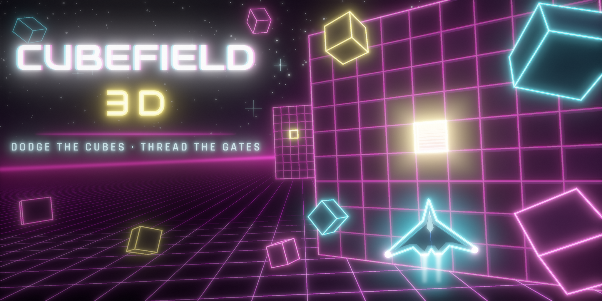

# BeamRunner

**BeamRunner** (working title) is a neon synthwave **runner where the track runs out and you build the rest**, for iOS
and Android (with desktop, keyboard and gamepad support). Your ship rides rails of light — three lanes on each of three
layers — and moves forward on its own. **Swipe left or right** to change lane, **tap** to build a bridge across the gap
ahead, **swipe up or down** to build a ramp to another layer. Every build costs **fuel**, picked up along the way —
often on the riskier routes. Miss a build and you drop a layer (and a hull point); fall two layers, off the bottom into
the void, or ramp into the ceiling and the run is over. Each level ends at a **wall** that carries you up to a
checkpoint with a perk pick. Gems buy **ship upgrades** (fuel tank, build efficiency, starting fuel, power-up time,
hull) between runs; power-ups — shield, magnet, Overload, instant build, repair — bend the rules for a few seconds, and a
hidden adaptive difficulty keeps each run challenging but fair. Almost everything — meshes, textures, materials,
particles, music, sound effects and UI — is generated procedurally at runtime. Design brief:
`Builder Runner – Design Doc.docx`.

It is a fork of **LightLancer** (itself forked from CubeField 3D and Neo Slipstream): the infrastructure — UI kit,
services (ads, IAP, online, saves), procedural audio, localization, ships and skins, tooling and CI — and the synthwave
world are shared; the track, building, fuel, falls, checkpoint, upgrades and adaptive difficulty are new (see
`docs/ARCHITECTURE.md` §§4–5 and §8).

> Parts of the feature list below are inherited from the earlier games and still describe their rules in places; the
> architecture document is the up-to-date contract.

<!-- FEATURES -->
## Features

**Gameplay**
- **Build the road as you ride it** — tap for a bridge (2 fuel), swipe up for a ramp up (3), swipe down for a ramp down
  (1); every build fills the next tile in your lane, shown by a ghost outline that lights up over gaps. A last-second
  build still counts — and pays a clutch bonus.
- **Three layers, hard edges** — the ceiling above the top layer and the void below the bottom one kill; a one-layer
  fall costs a hull point (a shield absorbs it).
- **Levels that teach** — 1 first bridges · 2 ramps and gem trails · 3 the edges · 4 the fuel line · from 5 obstacles
  that force new routes; from level 13 the mixed kinds repeat at full speed. Every level ends at a wall checkpoint:
  stats, a perk pick (refuel, patch, shield, lean builds, big tank, long boosts), or watch an ad to take all three.
- **Affordable by construction** — hand-made chunks are placed only when a route through them survives on the fuel a
  pilot can have there (a dynamic-programming route solver), and fuel chunks step in when the tank runs low.
- **Gem trails that lead you into building** — trails cross gaps and dip between layers; the richest run on the top
  layer under the ceiling.
- **Power-ups** — shield, magnet (pulls gems and fuel), Overload (speed, smashes obstacles, flies over gaps), instant
  build (free building), repair (full hull).
- **Hidden adaptive difficulty** (−2 … +2): speed, gaps, fuel, obstacles, drops, the gap warning's lead time and gem
  payout follow your results; the edges never change.
- **Start where you left off**, **continue once per run**, **Daily Run** with a ghost, first-run coaching hints.

**Progression**
- Fourteen ships (Arrow, the original Shuttle, Manta, Spark, Viper, Riptide, Halo, Venom, Eclipse, Phantom, Wraith,
  Aurora, Solaris, Nova): each unlocks with a requirement (level reached, best score, pilot rank, days flown in the
  Daily Run) and then a gem price.
- Three rotating missions; clearing a set ranks you up (+4% score per rank).
- 29 achievements, a local top-10 leaderboard, lifetime stats, and a seven-day login streak.
- Optional Google Play Games / Game Center leaderboards (all-time + Daily Run) and achievements, and cloud save
  across devices (Saved Games / iCloud) — off until the ids are set in `online.json`.

**Presentation**
- Pipeline-agnostic neon shaders: rails of light that snap into place as you build, a starry synthwave sky, neon-edged cubes
  and level walls, a grid floor far below the void, fog and a glowing horizon; URP bloom, vignette and chromatic aberration.
- A procedural synthwave soundtrack rendered at boot: the Run theme adds layers as speed and multiplier rise, with a
  lead hook in Overload; every sound effect is synthesized too.
- Juicy feedback: camera shake and FOV kicks, particle bursts, haptics, pitch-climbing gem chains, a palette per
  level.
- Glassy neon UI with procedural icons, safe-area aware, portrait-first and landscape-ready.
- 12 languages — English, Spanish, Portuguese (Brazil), French, German, Italian, Russian, Turkish, Polish,
  Japanese, Korean, Simplified Chinese — switchable in Settings without a restart, with per-script fonts
  (translations are machine-made and awaiting native review, see [docs/LOCALIZATION.md](docs/LOCALIZATION.md)).

**Platform**
- Touch swipes and taps (or tap-sides); keyboard, mouse and gamepad.
- Unity LevelPlay ad mediation (rewarded + rate-limited interstitials) with a GDPR/CCPA consent prompt and iOS
  App Tracking Transparency; Unity IAP 5 on Google Play Billing 9 / StoreKit (Remove Ads, gem packs, restore);
  a simulated ad flow in the Editor.
- Daily reminders (opt-in), a rating prompt every third launch (the game's dialog on Android, Apple's sheet on iOS),
  opt-in crash reporting (Sentry), signed saves that shrug off casual editing.
- Atomic saves with automatic backup recovery; auto-pause on app switch; graphics quality tiers and
  accessibility options (reduced flashing, invert up/down ramps, camera-shake and sensitivity sliders).
<!-- /FEATURES -->



## Getting started

1. Install **Unity 6000.3.25f1** (Unity 6.3 LTS, supported until December 2027) via Unity Hub, with the
   **Android Build Support** (incl. OpenJDK and Android SDK & NDK tools) and/or **iOS Build Support** modules.
   iOS builds are finished on a Mac with **Xcode 26** or later (App Store uploads need the iOS 26 SDK).
2. Unity Hub → *Add project from disk* → select the **`BeamRunner/`** folder of this repository (the
   repository root is not the Unity project).
3. After the first import, run **`BeamRunner ▸ Setup Project`**. It is idempotent and makes sure that:
   the main scene is scene 0 in Build Settings, URP (`Assets/Settings/PC_RPAsset`) is the default render
   pipeline, the colour space is Linear, company/product/bundle ids are set, the app is portrait-only,
   the app icon (and Android adaptive icon) is assigned, Android uses IL2CPP + ARM64 and targets API 36
   (minimum API 24, required by the Google Play Games plugin), and iOS targets 15.0 or later.
4. **`BeamRunner ▸ Open Main Scene`** (`Assets/BeamRunner/Scenes/Main.unity`) and press **Play**.
   By default Play Mode always starts from the main scene, whatever scene is open
   (toggle: *BeamRunner ▸ Play Mode Starts From Main Scene*).

Set the Game view to a portrait resolution (e.g. 1080×1920) — the game is designed for portrait phones.

> **First time?** This project was built and verified entirely without a Unity Editor (compile checks against
> real Unity 6 assemblies and the Unity 6.3 API, unit tests, runtime code reviews). Walk through
> **[docs/FIRST_RUN_CHECKLIST.md](docs/FIRST_RUN_CHECKLIST.md)** on your first open.

### Editor menu (`BeamRunner ▸ …`)

| Item | What it does |
|---|---|
| Setup Project | Idempotent fixer for build/graphics/player settings (summary dialog lists what changed). |
| Open Main Scene / Rebuild Main Scene | Opens the only scene / recreates it (one `BeamRunner` GameObject with `GameBootstrap`). |
| Validate Project | Checks scene & Build Settings, URP, shader compile errors, fonts, `monetization.json`, release placeholders, bundle ids, icon, IL2CPP/ARM64, keystore. Results in the Console + a dialog. |
| Reset Save Data / Open Save Folder | Deletes the Editor profile (`persistentDataPath/beamrunner_profile.json*`) and PlayerPrefs / reveals the folder. |
| Build ▸ Android App Bundle / Android APK (dev) / iOS Xcode Project | Validates, then builds into `BeamRunner/Builds/` (gitignored) and reports the result. |

Batch-mode entry points for CI:
`-executeMethod BeamRunner.EditorTools.FieldProjectValidator.ValidateBatch` (exit code 1 on errors) and
`-executeMethod BeamRunner.EditorTools.FieldBuildMenu.BuildFromCommandLine -fieldBuild aab|apk|ios`.

## Controls

| | Change lane | Bridge (next tile) | Ramp up / down (next tile) | Pause |
|---|---|---|---|---|
| Touch — **Swipe** (default) | Swipe left / right (keep sliding for a second lane) | Tap anywhere | Swipe up / down | Pause button, Android back |
| Touch — **Tap sides** | Tap the outer third of the screen | Tap the middle | Swipe up / down | Pause button |
| Keyboard | A / D or ← / → | Space or Enter | W / S or ↑ / ↓ | Esc or P |
| Mouse | Click-drag left / right | Click (right click also bridges) | Click-drag up / down | — |
| Gamepad | D-pad / stick left-right, bumpers | A / South or Right Trigger | D-pad / stick up-down, Y / B | Start |

The touch mode, sensitivity and *Invert up / down* (swaps the ramps) are in *Settings*.

## Project structure

```
BeamRunner/                      Unity project (open this folder in Unity)
  Assets/BeamRunner/
    Scripts/Core/                   pure C# simulation (asmdef, no UnityEngine) — levels, field, rules, meta, audio DSP
    Scripts/Runtime/                Unity layer — Boot, Game, Rendering, Audio, UI, Services
    Scripts/Editor/                 setup/validate/build tooling (menu "BeamRunner")
    Resources/BeamRunner/        shaders, fonts (+ OFL.txt), Config/*.json, Localization/<lang>.json (12 tables)
    Scenes/Main.unity               the only scene (one GameObject with GameBootstrap)
    Art/                            app icon, adaptive icon layers, promo/feature graphics
    Art/Source~/                    Python generators for that art and the splash art (ignored by Unity; ./build_all.sh)
    Tests/EditMode/                 NUnit tests for Core
  Assets/Settings/                  URP pipeline/renderer assets
docs/                               architecture, UI screens, store listing, privacy policy template
tools/                              headless compile check, meta generator, audio preview
```

The binding design contract — module boundaries, coordinate system, shader globals, game flow — is
**[docs/ARCHITECTURE.md](docs/ARCHITECTURE.md)**. See also [docs/UI_SCREENS.md](docs/UI_SCREENS.md),
[docs/STORE_LISTING.md](docs/STORE_LISTING.md) and [docs/PRIVACY_POLICY.md](docs/PRIVACY_POLICY.md).

## Checks without the Unity Editor

**Compile check + unit tests** — [`tools/unity-compile-check`](tools/unity-compile-check/README.md) compiles
every assembly of the project (Core, Core tests, Assembly-CSharp for Android/iOS/Editor, Assembly-CSharp-Editor)
with Roslyn against Unity reference assemblies, runs the Core NUnit tests with `dotnet test`, and audits Unity 6
API usage:

```bash
bash tools/unity-compile-check/setup.sh   # once per machine/container
bash tools/unity-compile-check/check.sh   # exit code 0 = all stages pass
```

In Claude Code on the web, `.claude/hooks/session-start.sh` runs `setup.sh` automatically when a session starts
(~2 min the first time, seconds once the container is cached); `CLAUDE.md` has the project notes for Claude.

See its README for stages, options and known false positives. In the Editor, the same tests run from
*Window ▸ General ▸ Test Runner ▸ EditMode*; *PlayMode* holds 8 smoke tests that boot the real game with a
throwaway save and drive it through every flow (see [docs/FIRST_RUN_CHECKLIST.md](docs/FIRST_RUN_CHECKLIST.md)).

**CI** — [`.github/workflows/checks.yml`](.github/workflows/checks.yml) runs the compile check, the unit tests and
`gen-metas.py --check` on every push and pull request (no Unity license needed; ~3 min cold, under a minute with
the cached toolchain). [`.github/workflows/unity-build.yml`](.github/workflows/unity-build.yml) (GameCI) runs the
EditMode + PlayMode tests in Unity 6000.3.25f1 and builds the `.aab` (plus the 16 KB check) and the iOS Xcode
project on `v*` tags or on demand, once the Unity secrets are set; without them it skips itself and stays green.
Secrets, versioning and local equivalents: **[docs/CI.md](docs/CI.md)**.

**`.meta` files** — every new file/folder under `Assets/` needs a `.meta`. When adding files outside the Editor:

```bash
python3 tools/gen-metas.py                     # create missing metas under BeamRunner/Assets/BeamRunner
python3 tools/gen-metas.py --check             # list missing / orphaned / duplicate-GUID metas, exit 1 if any
python3 tools/gen-metas.py PATH… [--dry-run] [--prune] [--no-parents]
```

GUIDs are deterministic (md5 of the project-relative path) and existing metas are never overwritten.

## Release checklist

- [ ] **Validate**: `BeamRunner ▸ Validate Project` shows no errors; review every warning.
- [ ] **Store requirements**: Android target API 36 (Google Play, new apps and updates since 31 Aug 2026; set by
      *Setup Project*), Google Play Billing 8+ (IAP 5.4.3 ships Billing 9), **16 KB page-size** support for 64-bit
      native libraries (run `python3 tools/check-16kb.py <your .aab>` — Unity's own libraries pass; it catches
      third-party ad SDKs that don't), Xcode 26 / iOS 26 SDK for App Store uploads, and an iOS **privacy manifest**
      (`Assets/Plugins/iOS/PrivacyInfo.xcprivacy`, merged by Unity and checked by the iOS build step — keep it in
      sync if the code starts using another required-reason API). Re-check both stores' current requirements
      before each submission.
- [ ] **Ads (Unity LevelPlay 9.5.1)**: in the LevelPlay dashboard create the Android and iOS apps, a Rewarded
      and an Interstitial ad unit for each, link **Unity Ads** (SDK Networks) and add active Unity Ads instances
      (game id + placements); put the **app keys** and **ad unit ids** in
      `Assets/BeamRunner/Resources/BeamRunner/Config/monetization.json` (`levelPlayAppKeyAndroid/Ios`,
      `rewardedAdUnitAndroid/Ios`, `interstitialAdUnitAndroid/Ios`). In the Editor: *Ads Mediation ▸ Network
      Manager* → **Update** the bundled LevelPlay SDK + Unity Ads (Unity Ads is required: ironSource Ads stopped
      direct demand on 30 Apr 2026) and enable **SKAdNetwork IDs**; Ads Mediation settings →
      auto-init **off**, adapter debug / integration helper **off**, **`DeclareAD_IDPermission` on** (Android 13+);
      resolve native dependencies with the **External Dependency Manager / Mobile Dependency Resolver**
      (*Android Resolver ▸ Resolve*, *iOS Resolver ▸ Install Cocoapods*, then build from the `.xcworkspace`).
      Details: `Assets/BeamRunner/Scripts/Runtime/Services/README.md`. Android/iOS **release builds fail**
      while a platform's app key / ad units or the privacy policy URL are missing (`FieldMonetizationBuildGuard`;
      `"allowIncompleteReleaseBuild": true` only for test-track builds — set it back to **false** for the store).
- [ ] **Getting paid**: Google Play **payments profile** (merchant account, bank, tax); App Store Connect **Paid
      Apps agreement** (bank + tax); LevelPlay **payout method and tax form**. Publish **`app-ads.txt`** (lines from
      the LevelPlay / Unity Ads dashboards) at the root of the developer website named in both store listings and
      enter that site in the ad dashboards — without it ad fill and eCPM drop.
- [ ] **Ads on devices**: development build + dashboard test devices → LevelPlay Test Suite (`testMode: true`
      opens it in development builds only), rewarded watched (reward) / skipped (none), interstitial pacing,
      airplane mode; iOS: the ATT prompt shows once after choosing personalised ads and its text
      (`NSUserTrackingUsageDescription`, added by the build) is present in the Xcode project's Info.plist.
- [ ] **In-app purchases**: create every product listed in `monetization.json` (`beamrunner.removeads`
      non-consumable, `beamrunner.gems.*` consumables) with **identical ids** in Google Play Console and
      App Store Connect; set `iosAppId` (numeric Apple ID) for store/rating links.
- [ ] **Online services (optional)**: Play Console → Play Games Services (SHA-1 of the upload **and** Play
      app-signing keys, leaderboards: best score + Daily Run, the 29 achievements, Saved Games); in Unity
      *Window ▸ Google Play Games ▸ Setup ▸ Android Setup* and commit the generated files. App Store Connect →
      Game Center (daily leaderboard = recurring from 00:00 UTC, achievements; iCloud on the App ID for cloud save).
      Fill `Resources/BeamRunner/Config/online.json`; *Validate Project* lists what's missing. Until Android
      Setup is done, Android builds end with a "Google Play Games not configured" warning dialog (harmless).
- [ ] **Crash reporting (optional, Sentry 4.10.3)**: create a Sentry project, set `crashReportingDsn`, run
      *BeamRunner ▸ Crash Reporting ▸ Set Up Sentry Options*, add the auth token in *Tools ▸ Sentry ▸ Debug
      Symbols* (kept in the git-ignored `SentryCliOptions.asset`), enable *Prevent Storing of IP Addresses*, and run
      `tools/check-16kb.py` on the `.aab` (Sentry adds `libsentry.so`).
- [ ] **Reminders & reviews**: *Android Resolver ▸ Resolve* (Play review 2.0.2); *Validate Project* confirms the
      iOS notification permission is not requested at launch and the `field_notification_small` icon is registered.
- [ ] **Translations**: have a native speaker review each language in `Resources/BeamRunner/Localization/`
      (consent and privacy texts first), then set its `_meta.machineTranslated` to false; translate the store
      listing and privacy policy for the languages you launch in. See [docs/LOCALIZATION.md](docs/LOCALIZATION.md).
- [ ] **Privacy policy**: publish [docs/PRIVACY_POLICY.md](docs/PRIVACY_POLICY.md) and
      [docs/TERMS_OF_USE.md](docs/TERMS_OF_USE.md) as web pages at public URLs (Google Play rejects PDF links; a
      Google Doc via *File ▸ Share ▸ Publish to web* works) and update their "Last updated" date with every change;
      set `privacyPolicyUrl`, `termsUrl` and `supportEmail` in `monetization.json` and in both store listings;
      complete Google Play *Data safety* and the App Store privacy labels (LevelPlay and its networks collect
      device identifiers; iOS asks for tracking via App Tracking Transparency).
- [ ] **Signing**: Android — create an upload keystore (*Player Settings ▸ Publishing Settings*) and enrol in
      Play App Signing; iOS — set the Apple Developer Team in Xcode (automatic signing) and archive.
- [ ] **Versioning**: bump *Version* (`bundleVersion`, currently 1.0.0) and the Android *Bundle Version Code* /
      iOS *Build* number for every upload.
- [ ] **Icons**: the default icon (`Art/Icon/AppIcon.png`, 1024², no alpha) and Android adaptive layers are
      assigned by *Setup Project*; check them in *Player Settings ▸ Icon* for each platform.
- [ ] **Store listing**: copy, keywords and screenshot plan in [docs/STORE_LISTING.md](docs/STORE_LISTING.md);
      feature graphic `Art/Promo/FeatureGraphicPlay1024x500.png` (Google Play) / `FeatureGraphic.png` (2048×1024);
      content rating questionnaires (ads: yes, IAP: yes).
- [ ] **Builds**: `BeamRunner ▸ Build ▸ Android App Bundle` → upload the `.aab`;
      `Build ▸ iOS Xcode Project` → archive in Xcode → upload with Xcode/Transporter. Smoke-test on a low-end
      Android phone and an iPhone (notch/safe area, 60 fps, audio, purchases in sandbox, ads on test devices).

## Credits

- **Fonts** (SIL Open Font License 1.1; licence texts in `Assets/BeamRunner/Resources/BeamRunner/Fonts/OFL.txt`):
  [Audiowide](https://fonts.google.com/specimen/Audiowide) (Astigmatic), [Rajdhani](https://fonts.google.com/specimen/Rajdhani)
  (Indian Type Foundry), Russo One by Jovanny Lemonad (subset shipped as "Neo Title Cyrillic" — "Russo" is a
  Reserved Font Name), Tektur (The Tektur Project Authors), Noto Sans JP/KR/SC (Adobe/Google). The Cyrillic and
  CJK fonts are subsets built by `tools/build-fonts.py` from pinned google/fonts sources.
- **Translations**: machine-made (AI), pending native review — see [docs/LOCALIZATION.md](docs/LOCALIZATION.md).
- **Google Play Games plugin for Unity** 2.2.1 (vendored in `Assets/GooglePlayGames/`), Apache License 2.0
  (licence text next to it). **Sentry SDK for Unity** 4.10.3 (package), MIT licence.
- **Everything else** — the field, cubes, gates, ships, effects, textures, music, sound effects, UI and the app
  icon/promo art — is procedurally generated by the game's own code.
- Built with Unity 6.3 LTS and the Universal Render Pipeline.
